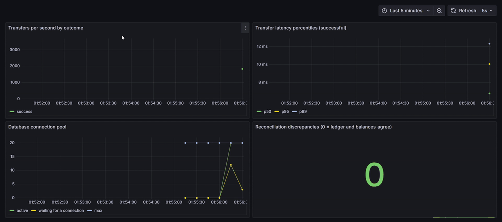
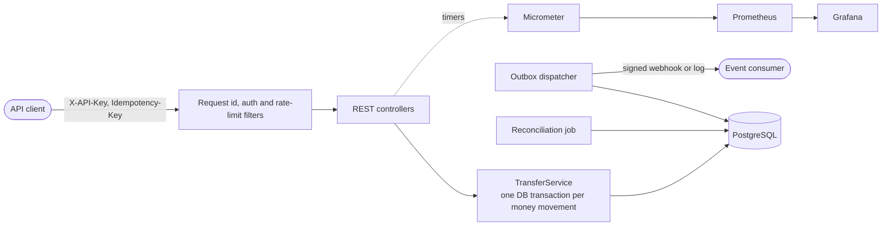

# LedgerX

**A transaction-safe wallet and payments engine.** Balances stay correct under concurrent requests, retried requests never move money twice, refunds compensate instead of rewriting history, and every movement is recorded in an append-only double-entry ledger.




*The provisioned Grafana dashboard during a 45 s load test: transfer rate, server-side latency percentiles, connection pool usage, and the reconciliation check staying at 0.*

## Contents

- [Why this project](#why-this-project)
- [Guarantees](#guarantees)
- [Quick start](#quick-start)
- [Try it](#try-it)
- [API reference](#api-reference)
- [Events and webhooks](#events-and-webhooks)
- [Performance](#performance)
- [Architecture](#architecture)
- [Testing and quality](#testing-and-quality)
- [Configuration](#configuration)
- [Observability and operations](#observability-and-operations)
- [Project structure](#project-structure)
- [Limitations and future work](#limitations-and-future-work)

## Why this project

Moving money is a small feature with hard failure modes: two requests spending the same balance, a client retrying a timed-out request, a server dying halfway through a transfer, a notification lost after the money moved. LedgerX is built around those cases. Each one has a test that tries to break it, and a reconciliation job that audits the result.

## Guarantees

| Guarantee | How it is enforced | Verified by |
|---|---|---|
| Money is never created or destroyed (all balances sum to zero) | Every transfer is a debit plus an equal credit; deposits come from a per-currency external wallet | `ConcurrencyIT`, `ReconciliationIT` |
| A wallet never overspends, even under concurrent requests | Row locks in a fixed order, or a guarded `UPDATE ... WHERE balance >= :amount`, plus a `CHECK (balance >= 0)` constraint | `ConcurrencyIT` (100 concurrent transfers against a balance for 10) |
| A retried request moves money once | Idempotency key stored in the same transaction as the transfer | `ConcurrencyIT` (20 concurrent duplicates execute once) |
| No half-finished transfer after a failure | One database transaction per transfer | `FailureIT` (injected error, killed database session) |
| The ledger cannot be rewritten | Database trigger rejects `UPDATE` and `DELETE` on ledger entries | `TransferServiceIT` |
| A transfer is refunded at most once | Row lock plus a unique partial index; the refund is a new compensating transfer | `ReversalIT` (12 concurrent refunds produce exactly one) |
| An event exists if and only if its transfer committed | Transactional outbox: the event row is written in the transfer's transaction | `OutboxIT` |
| Events are delivered at least once, never twice by concurrent dispatchers | Retry with backoff; `FOR UPDATE SKIP LOCKED` | `OutboxIT` (four racing dispatchers) |
| A client only spends from its own wallets | Ownership check on the source wallet before any money moves; other clients' wallets return 404 | `ApiIT` |
| Keys can be rotated without downtime and revoked instantly | Several keys per client with expiry and revocation | `KeyRotationIT` |
| One client cannot overwhelm the service | Per-client token bucket answering `429` with `Retry-After` | `RateLimiterTest`, `RateLimitIT` |
| Corruption is detected | Reconciliation compares balances with the ledger and checks every transfer and reversal | `ReconciliationIT` (corrupts data on purpose) |

## Quick start

Requires Docker.

```bash
docker compose up --build
```

The API is then available on **http://localhost:8081** (set `APP_PORT` to change it), with interactive documentation at **http://localhost:8081/swagger-ui.html**. The default admin key for local use is `dev-admin-key`.

To add Prometheus and Grafana (dashboard at http://localhost:3000, no login):

```bash
docker compose --profile monitoring up -d
```

Running from source instead (Java 21, database in Docker):

```bash
docker compose up -d postgres
LEDGERX_ADMIN_KEY=dev-admin-key ./mvnw spring-boot:run   # serves on port 8080
```

With the stack running, `bash scripts/smoke-test.sh` exercises the whole API end to end (transfer, retry, conflict, refund, key rotation, reconciliation, metrics) and fails on any unexpected status. CI runs the same script against the built Docker image.

## Try it

The commands below use `curl` against the Docker setup. On Windows PowerShell use `curl.exe`.

```bash
BASE=http://localhost:8081

# 1. Create an API client. The key is shown once.
curl -s -X POST $BASE/admin/clients -H "X-Admin-Key: dev-admin-key" \
  -H "Content-Type: application/json" -d '{"name":"demo"}'
# -> {"id":"...","name":"demo","apiKey":"lx_..."}

API_KEY=lx_...   # paste the apiKey from the response

# 2. Create two wallets (note the "id" in each response)
curl -s -X POST $BASE/wallets -H "X-API-Key: $API_KEY" -H "Content-Type: application/json" \
  -d '{"owner":"alice","currency":"INR"}'
curl -s -X POST $BASE/wallets -H "X-API-Key: $API_KEY" -H "Content-Type: application/json" \
  -d '{"owner":"bob","currency":"INR"}'

# 3. Fund alice with 5,000 paise
curl -s -X POST $BASE/wallets/$ALICE/deposit -H "X-API-Key: $API_KEY" \
  -H "Content-Type: application/json" -d '{"amount":5000}'

# 4. Transfer 1,200 paise. Run this twice: the second call returns 200 with the
#    original transfer and header "Idempotent-Replayed: true", and moves no money.
curl -s -i -X POST $BASE/transfers -H "X-API-Key: $API_KEY" -H "Idempotency-Key: order-1001" \
  -H "Content-Type: application/json" \
  -d "{\"fromWalletId\":\"$ALICE\",\"toWalletId\":\"$BOB\",\"amount\":1200}"

# 5. Refund it (by the owner of the receiving wallet). The money moves back through a
#    new transfer that points at the original; a second refund returns 409.
curl -s -X POST $BASE/transfers/$TRANSFER_ID/reverse -H "X-API-Key: $API_KEY" -H "Idempotency-Key: refund-1001"

# 6. Rotate your key without downtime: the old key keeps working for the grace period
curl -s -X POST $BASE/keys/rotate -H "X-API-Key: $API_KEY" -H "Content-Type: application/json" \
  -d '{"gracePeriodSeconds":3600}'

# 7. Audit the ledger
curl -s -H "X-Admin-Key: dev-admin-key" $BASE/admin/reconciliation
# -> {"consistent":true,"discrepancies":0,...,"totalBalance":0}
```

## API reference

Full interactive documentation: `/swagger-ui.html` (machine-readable spec at `/v3/api-docs`). All endpoints except `/actuator/*`, `/admin/*` and the docs require an `X-API-Key` header. Amounts are integer minor units (paise, cents). Supported currencies: INR, USD, EUR.

| Method | Path | Description | Notes |
|---|---|---|---|
| `POST` | `/wallets` | Create a wallet owned by the calling client | body: `owner`, `currency` |
| `GET` | `/wallets/{id}` | Read one of your wallets | 404 for unknown or foreign wallets |
| `POST` | `/wallets/{id}/deposit` | Fund one of your wallets | body: `amount` |
| `POST` | `/transfers` | Move money from one of your wallets to any wallet | `Idempotency-Key` header required; body: `fromWalletId`, `toWalletId`, `amount` |
| `GET` | `/transfers/{id}` | Read a transfer | visible to the owners of either wallet |
| `POST` | `/transfers/{id}/reverse` | Refund a transfer you received | `Idempotency-Key` header required; once per transfer |
| `POST` | `/keys/rotate` | Issue a new API key | body: optional `gracePeriodSeconds` (0 to 604800, default 3600) |
| `GET` | `/keys` | List your keys | metadata only, never secrets |
| `DELETE` | `/keys/{id}` | Revoke a key immediately | refuses to revoke your last active key |
| `POST` | `/admin/clients` | Create an API client | `X-Admin-Key` header |
| `GET` | `/admin/reconciliation` | Run the ledger audit now | `X-Admin-Key` header |
| `GET` | `/admin/outbox` | Event backlog: pending and dead counts | `X-Admin-Key` header |
| `POST` | `/admin/outbox/requeue-dead` | Replay events that exhausted their retries | `X-Admin-Key` header |

| Status | Meaning |
|---|---|
| `201` | Created (wallet, deposit, new transfer or reversal, new key) |
| `200` | Idempotent replay: the original result is returned, with `Idempotent-Replayed: true` |
| `400` | Invalid input, unsupported currency, missing `Idempotency-Key`, or a transfer that cannot be reversed (deposit, or already a reversal) |
| `401` | Missing, invalid, expired or revoked `X-API-Key` |
| `404` | Wallet or transfer does not exist or is not yours to see |
| `409` | `Idempotency-Key` reused with a different request, transfer already reversed, or last active key |
| `422` | Insufficient funds (including a refund whose money was already spent) |
| `429` | Rate limit exceeded; see the `Retry-After` header |

Every response carries an `X-Request-Id` header that also appears in the logs.

## Events and webhooks

Every deposit, transfer and reversal produces an event (`transfer.completed` or `transfer.reversed`) through a transactional outbox, so an event exists if and only if the money actually moved. By default events are written to the application log. To deliver them to a service of your own, set a webhook URL and secret:

```bash
LEDGERX_OUTBOX_WEBHOOK_URL=https://example.com/hooks/ledgerx
LEDGERX_OUTBOX_WEBHOOK_SECRET=change-me
```

Each event is an HTTP `POST` with a JSON body and these headers:

| Header | Meaning |
|---|---|
| `X-Ledgerx-Event-Id` | Stable event id. Delivery is at-least-once, so **deduplicate on this** |
| `X-Ledgerx-Event-Type` | `transfer.completed` or `transfer.reversed` |
| `X-Ledgerx-Signature` | `sha256=` followed by the hex HMAC-SHA256 of the raw body with your secret |

Body:

```json
{"transferId":"...","fromWalletId":"...","toWalletId":"...","amount":1200,"currency":"INR","reversesTransferId":null,"occurredAt":"2026-10-21T02:00:00Z"}
```

Verify a delivery (Python):

```python
import hashlib, hmac

def is_authentic(raw_body: bytes, header: str, secret: str) -> bool:
    expected = "sha256=" + hmac.new(secret.encode(), raw_body, hashlib.sha256).hexdigest()
    return hmac.compare_digest(expected, header)
```

Any non-2xx response or timeout counts as a failure and is retried with exponential backoff (2, 4, 8, ... seconds, capped at 5 minutes). After 10 attempts an event is marked dead; dead events are visible at `GET /admin/outbox` and the metric `ledgerx_outbox_dead`, and can be replayed with `POST /admin/outbox/requeue-dead`. Ordering is not guaranteed across retries.

## Performance

Load test: k6, 32 virtual users, 60 s per run, one transfer of 1 paisa per request. One laptop (Intel Core i7-13650HX) runs the application, PostgreSQL and the load generator together, so the numbers show relative behaviour, not production capacity.

**These figures were measured at v0.4, before reversals, the outbox and rate limiting were added.** The outbox adds one more insert to every transfer, so current throughput will be somewhat lower. Re-run `./loadtest/run.ps1` (3 repeats per configuration, reports median and range) to refresh them before quoting any number.

| Lock strategy | Wallets | Throughput | p50 | p95 | p99 | Failed |
|---|---|---|---|---|---|---|
| Pessimistic (`FOR UPDATE`) | 1000 | 2,224 transfers/s | 12.1 ms | 18.5 ms | 23.9 ms | 0% |
| Conditional update | 1000 | 2,066 transfers/s | 12.9 ms | 19.4 ms | 26.5 ms | 0% |
| Pessimistic (`FOR UPDATE`) | 2 | 340 transfers/s | 60.4 ms | 250.4 ms | 401.0 ms | 0% |
| Conditional update | 2 | 351 transfers/s | 44.5 ms | 274.8 ms | 439.5 ms | 0% |

- Contention matters far more than the locking strategy: when every request hits the same two wallets, throughput drops about 6x and p99 latency rises about 17x.
- The two strategies are not meaningfully different in these single runs. The gaps change sign between contention levels and are within run-to-run noise.
- After the runs, reconciliation reported zero discrepancies.

Method, environment and caveats: [docs/BENCHMARKS.md](docs/BENCHMARKS.md).

## Architecture



Key design decisions:

- **Money is `BIGINT` minor units**, never floating point.
- **A cached balance sits next to the ledger.** Reads are cheap, and reconciliation proves the two never disagree.
- **Two interchangeable lock strategies** (`PESSIMISTIC`, `CONDITIONAL_UPDATE`) selected by configuration, so they can be measured against each other.
- **Idempotency lives in the same transaction as the transfer**, so there is no window where money moved but the key was lost. A failed transfer does not consume its key.
- **Refunds compensate, never mutate.** A reversal is a new transfer pointing at the original, so history stays intact.
- **A transactional outbox instead of a message broker.** Reliable event delivery using the database the system already depends on.

Full write-up with sequence diagrams, the invariants-to-tests table and trade-offs: [docs/ARCHITECTURE.md](docs/ARCHITECTURE.md).

## Testing and quality

Tests run against a real PostgreSQL started by Testcontainers (locking and constraints cannot be tested against an in-memory database). Docker must be running.

```bash
./mvnw verify
```

88 tests. Line coverage is about 98% and branch coverage about 91% (unit and integration tests combined); the build **fails if coverage drops below 93% lines or 85% branches**, so it cannot regress unnoticed. The HTML report is in `target/site/jacoco` and is uploaded as a CI artifact.

| Test class | Covers |
|---|---|
| `TransferServiceIT` | Balanced ledger entries, overdraft rejection, invalid transfers, append-only ledger, balance equals ledger sum |
| `ConcurrencyIT` | Concurrent overspend, opposing transfers (no deadlock), concurrent duplicate requests, key reuse, failed-transfer retry. Run against both lock strategies |
| `FailureIT` | Fault injection: an error thrown mid-transfer, and a database session killed mid-transfer. Nothing is left half-committed and a retry succeeds |
| `ReversalIT` | Refund semantics, once-only under 12 concurrent attempts, spent funds, ownership, database-level backstop, reconciliation of reversals |
| `OutboxIT`, `OutboxUnitTest` | Atomic event writes, ordered delivery, retry with backoff, dead-lettering and requeue, racing dispatchers, webhook signing and failures |
| `KeyRotationIT` | Grace periods, expiry, immediate revocation, never revoking the last key, isolation between clients |
| `RateLimitIT`, `RateLimiterTest` | Burst and refill, `429` with `Retry-After`, per-client buckets, thread safety |
| `ReconciliationIT`, `SchedulersIT` | Deliberately corrupts data and checks the audit reports it; the scheduled jobs |
| `ApiIT`, `OpenApiIT`, `AdminOutboxIT` | Authentication, ownership, per-client idempotency, status codes, validation, API documentation, admin endpoints |

CI (GitHub Actions) runs two jobs on every push: the full build with the coverage gate, and a Docker job that builds the image, starts the stack and runs `scripts/smoke-test.sh` against it. Dependabot keeps Maven, Docker and Actions dependencies current.

## Configuration

| Setting | Default | Description |
|---|---|---|
| `LEDGERX_ADMIN_KEY` | empty (admin endpoints disabled) | Key for `/admin/*`. `docker compose` defaults it to `dev-admin-key` |
| `LEDGERX_TRANSFER_LOCK_STRATEGY` | `PESSIMISTIC` | `PESSIMISTIC` or `CONDITIONAL_UPDATE` |
| `LEDGERX_RATE_LIMIT_ENABLED` | `true` | Per-client rate limiting on or off |
| `LEDGERX_RATE_LIMIT_REQUESTS_PER_SECOND` | `100` | Sustained rate per client |
| `LEDGERX_RATE_LIMIT_BURST` | `200` | Burst capacity per client |
| `LEDGERX_OUTBOX_WEBHOOK_URL` | empty (events are logged) | Where to deliver events |
| `LEDGERX_OUTBOX_WEBHOOK_SECRET` | empty | HMAC key used to sign webhook bodies |
| `LEDGERX_OUTBOX_BATCH_SIZE` / `MAX_ATTEMPTS` | `20` / `10` | Dispatcher batch size and retries before an event is dead |
| `LEDGERX_RECONCILIATION_INTERVAL` | `PT5M` | Time between scheduled audits (ISO-8601 duration) |
| `SPRING_DATASOURCE_URL` | `jdbc:postgresql://localhost:5432/ledgerx` | Database connection |
| `SPRING_DATASOURCE_HIKARI_MAXIMUM_POOL_SIZE` | Hikari default (10); 20 in `docker compose` | Connection pool size |
| `APP_PORT` | `8081` | Host port for the containerised app (`docker compose` only) |

## Observability and operations

- **Metrics:** `/actuator/prometheus` exposes `ledgerx_transfer_seconds` (count, sum, histogram buckets) tagged by `outcome` and `strategy`; `ledgerx_outbox_pending`, `_dead`, `_delivered_total`, `_failed_total`; `ledgerx_rate_limit_rejected_total`; `ledgerx_reconciliation_discrepancies`; plus connection pool and JVM metrics. A Grafana dashboard is provisioned from `observability/`.
- **Logs:** every request has an id (`X-Request-Id`, honoured if supplied). Containers log JSON in ECS format.
- **Reconciliation:** runs every 5 minutes and on demand (`GET /admin/reconciliation`). It reads one consistent snapshot, so concurrent transfers cannot cause false alarms. Any discrepancy is logged at ERROR.
- **Diagnosing a slow transfer:** compare latency by `outcome`, check `hikaricp_connections_pending` (requests waiting for a connection means the pool or transaction length is the limit), then run the reconciliation.
- **Event backlog:** `ledgerx_outbox_pending` growing, or `ledgerx_outbox_dead` above zero, means the consumer is not receiving events. `GET /admin/outbox` shows the numbers; fix the consumer, then `POST /admin/outbox/requeue-dead`.

## Project structure

```
src/main/java/com/ledgerx/
  api/              controllers, auth, request-id and rate-limit filters, OpenAPI config
  client/           API clients and keys (hashing, rotation, revocation)
  outbox/           transactional outbox, dispatcher, webhook publisher
  ratelimit/        per-client token bucket
  reconciliation/   ledger audit and scheduled job
  transfer/         transfer service, reversals, lock strategies, idempotency
  wallet/           wallet model and repository
src/main/resources/db/migration/   Flyway migrations V1 to V6
src/test/java/      unit and integration tests (Testcontainers)
scripts/            end-to-end smoke test
loadtest/           k6 script and benchmark runner
observability/      Prometheus config and Grafana dashboard
docs/               architecture, benchmarks, demo
```

## Limitations and future work

- Single PostgreSQL primary; throughput is bounded by one database. No sharding, replication or failover.
- Rate limiting is per application instance (in memory); a global limit across instances would need a shared store such as Redis.
- API keys have no scopes: any key can do everything its client can do.
- One currency per transfer; no foreign-exchange transfers.
- Reconciliation detects problems but does not repair them.
- Event delivery is at-least-once and unordered under retries; consumers must deduplicate on the event id.
- Benchmarks are single-machine and pre-date the outbox; see [docs/BENCHMARKS.md](docs/BENCHMARKS.md).
- Possible next steps: pluggable broker publishers (Kafka, SQS) behind the existing `EventPublisher` interface, scoped API keys, a Redis-backed rate limiter, and automated repair proposals from reconciliation.
