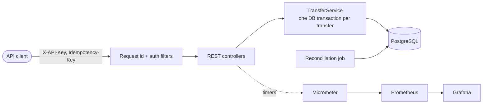

# LedgerX

**A transaction-safe wallet and payments engine.** Balances stay correct under concurrent requests, retried requests never move money twice, and every movement is recorded in an append-only double-entry ledger.


*The provisioned Grafana dashboard during a 45 s load test: transfer rate, server-side latency percentiles, connection pool usage, and the reconciliation check staying at 0.*

## Contents

- [Why this project](#why-this-project)
- [Guarantees](#guarantees)
- [Quick start](#quick-start)
- [Try it](#try-it)
- [API reference](#api-reference)
- [Performance](#performance)
- [Architecture](#architecture)
- [Testing](#testing)
- [Configuration](#configuration)
- [Observability and operations](#observability-and-operations)
- [Project structure](#project-structure)
- [Limitations and future work](#limitations-and-future-work)

## Why this project

Moving money is a small feature with hard failure modes: two requests spending the same balance, a client retrying a timed-out request, a server dying halfway through a transfer. LedgerX is built around those cases. Each one has a test that tries to break it, and a reconciliation job that audits the result.

## Guarantees

| Guarantee | How it is enforced | Verified by |
|---|---|---|
| Money is never created or destroyed (all balances sum to zero) | Every transfer is a debit plus an equal credit; deposits come from a per-currency external wallet | `ConcurrencyIT`, `ReconciliationIT` |
| A wallet never overspends, even under concurrent requests | Row locks in a fixed order, or a guarded `UPDATE ... WHERE balance >= :amount`, plus a `CHECK (balance >= 0)` constraint | `ConcurrencyIT` (100 concurrent transfers against a balance for 10) |
| A retried request moves money once | Idempotency key stored in the same transaction as the transfer | `ConcurrencyIT` (20 concurrent duplicates execute once) |
| No half-finished transfer after a failure | One database transaction per transfer | `FailureIT` (injected error, killed database session) |
| The ledger cannot be rewritten | Database trigger rejects `UPDATE` and `DELETE` on ledger entries | `TransferServiceIT` |
| A client only spends from its own wallets | Ownership check on the source wallet before any money moves; other clients' wallets return 404 | `ApiIT` |
| Corruption is detected | Reconciliation compares balances with the ledger and checks every transfer is balanced | `ReconciliationIT` (corrupts data on purpose) |

## Quick start

Requires Docker.

```bash
docker compose up --build
```

The API is then available on **http://localhost:8081** (set `APP_PORT` to change it). The default admin key for local use is `dev-admin-key`.

To add Prometheus and Grafana (dashboard at http://localhost:3000, no login):

```bash
docker compose --profile monitoring up -d
```

Running from source instead (Java 21, database in Docker):

```bash
docker compose up -d postgres
LEDGERX_ADMIN_KEY=dev-admin-key ./mvnw spring-boot:run   # serves on port 8080
```

## Try it

The commands below use `curl` against the Docker setup. On Windows PowerShell use `curl.exe`.

```bash
BASE=http://localhost:8081

# 1. Create an API client. The key is shown once.
curl -s -X POST $BASE/admin/clients -H "X-Admin-Key: dev-admin-key" \
  -H "Content-Type: application/json" -d '{"name":"demo"}'
# -> {"id":"...","name":"demo","apiKey":"lx_..."}

API_KEY=lx_...   # paste the apiKey from the response

# 2. Create two wallets (note the "id" in each response)
curl -s -X POST $BASE/wallets -H "X-API-Key: $API_KEY" -H "Content-Type: application/json" \
  -d '{"owner":"alice","currency":"INR"}'
curl -s -X POST $BASE/wallets -H "X-API-Key: $API_KEY" -H "Content-Type: application/json" \
  -d '{"owner":"bob","currency":"INR"}'

# 3. Fund alice with 5,000 paise
curl -s -X POST $BASE/wallets/$ALICE/deposit -H "X-API-Key: $API_KEY" \
  -H "Content-Type: application/json" -d '{"amount":5000}'

# 4. Transfer 1,200 paise. Run this twice: the second call returns 200 with the
#    original transfer and header "Idempotent-Replayed: true", and moves no money.
curl -s -i -X POST $BASE/transfers -H "X-API-Key: $API_KEY" -H "Idempotency-Key: order-1001" \
  -H "Content-Type: application/json" \
  -d "{\"fromWalletId\":\"$ALICE\",\"toWalletId\":\"$BOB\",\"amount\":1200}"

# 5. Audit the ledger
curl -s -H "X-Admin-Key: dev-admin-key" $BASE/admin/reconciliation
# -> {"consistent":true,"discrepancies":0,...,"totalBalance":0}
```

## API reference

All endpoints except `/actuator/*` and `/admin/*` require an `X-API-Key` header. Amounts are integer minor units (paise, cents). Supported currencies: INR, USD, EUR.

| Method | Path | Description | Notes |
|---|---|---|---|
| `POST` | `/wallets` | Create a wallet owned by the calling client | body: `owner`, `currency` |
| `GET` | `/wallets/{id}` | Read one of your wallets | 404 for unknown or foreign wallets |
| `POST` | `/wallets/{id}/deposit` | Fund one of your wallets | body: `amount` |
| `POST` | `/transfers` | Move money from one of your wallets to any wallet | requires `Idempotency-Key` header; body: `fromWalletId`, `toWalletId`, `amount` |
| `POST` | `/admin/clients` | Create an API client | `X-Admin-Key` header |
| `GET` | `/admin/reconciliation` | Run the ledger audit now | `X-Admin-Key` header |

| Status | Meaning |
|---|---|
| `201` | Created (wallet, deposit, new transfer) |
| `200` | Idempotent replay: the original result is returned, with `Idempotent-Replayed: true` |
| `400` | Invalid input, unsupported currency, or missing `Idempotency-Key` |
| `401` | Missing or invalid `X-API-Key` |
| `404` | Wallet does not exist or belongs to another client |
| `409` | `Idempotency-Key` was already used with a different request |
| `422` | Insufficient funds |

Every response carries an `X-Request-Id` header that also appears in the logs.

## Performance

Load test: k6, 32 virtual users, 60 s per run, one transfer of 1 paisa per request. One laptop (Intel Core i7-13650HX) runs the application, PostgreSQL and the load generator together, so the numbers show relative behaviour, not production capacity.

| Lock strategy | Wallets | Throughput | p50 | p95 | p99 | Failed |
|---|---|---|---|---|---|---|
| Pessimistic (`FOR UPDATE`) | 1000 | 2,224 transfers/s | 12.1 ms | 18.5 ms | 23.9 ms | 0% |
| Conditional update | 1000 | 2,066 transfers/s | 12.9 ms | 19.4 ms | 26.5 ms | 0% |
| Pessimistic (`FOR UPDATE`) | 2 | 340 transfers/s | 60.4 ms | 250.4 ms | 401.0 ms | 0% |
| Conditional update | 2 | 351 transfers/s | 44.5 ms | 274.8 ms | 439.5 ms | 0% |

- Contention matters far more than the locking strategy: when every request hits the same two wallets, throughput drops about 6x and p99 latency rises about 17x.
- The two strategies are not meaningfully different in these single runs. The gaps change sign between contention levels and are within run-to-run noise.
- After the runs, reconciliation reported zero discrepancies.

Method, environment and caveats: [docs/BENCHMARKS.md](docs/BENCHMARKS.md). Reproduce with `./loadtest/run.ps1`.

## Architecture



Key design decisions:

- **Money is `BIGINT` minor units**, never floating point.
- **A cached balance sits next to the ledger.** Reads are cheap, and reconciliation proves the two never disagree.
- **Two interchangeable lock strategies** (`PESSIMISTIC`, `CONDITIONAL_UPDATE`) selected by configuration, so they can be measured against each other.
- **Idempotency lives in the same transaction as the transfer**, so there is no window where money moved but the key was lost. A failed transfer does not consume its key.
- **No message broker or extra services.** Everything that matters is a single PostgreSQL transaction.

Full write-up with sequence diagrams, invariants and trade-offs: [docs/ARCHITECTURE.md](docs/ARCHITECTURE.md).

## Testing

Tests run against a real PostgreSQL started by Testcontainers (locking and constraints cannot be tested against an in-memory database). Docker must be running.

```bash
./mvnw verify
```

| Test class | Covers |
|---|---|
| `TransferServiceIT` | Balanced ledger entries, overdraft rejection, invalid transfers, append-only ledger, balance equals ledger sum |
| `ConcurrencyIT` | Concurrent overspend, opposing transfers (no deadlock), concurrent duplicate requests, key reuse, failed-transfer retry. Run against both lock strategies |
| `FailureIT` | Fault injection: an error thrown mid-transfer, and a database session killed mid-transfer. Nothing is left half-committed and a retry succeeds |
| `ReconciliationIT` | Deliberately corrupts balances and ledger entries and checks the audit reports them |
| `ApiIT` | Authentication, ownership, per-client idempotency, status codes, validation |

## Configuration

| Setting | Default | Description |
|---|---|---|
| `LEDGERX_ADMIN_KEY` | empty (admin endpoints disabled) | Key for `/admin/*`. `docker compose` defaults it to `dev-admin-key` |
| `LEDGERX_TRANSFER_LOCK_STRATEGY` | `PESSIMISTIC` | `PESSIMISTIC` or `CONDITIONAL_UPDATE` |
| `SPRING_DATASOURCE_URL` | `jdbc:postgresql://localhost:5432/ledgerx` | Database connection |
| `SPRING_DATASOURCE_HIKARI_MAXIMUM_POOL_SIZE` | Hikari default (10); 20 in `docker compose` | Connection pool size |
| `ledgerx.reconciliation.enabled` | `true` | Scheduled audit on or off |
| `ledgerx.reconciliation.interval` | `PT5M` | Time between audits (ISO-8601 duration) |
| `APP_PORT` | `8081` | Host port for the containerised app (`docker compose` only) |

## Observability and operations

- **Metrics:** `/actuator/prometheus` exposes `ledgerx_transfer_seconds` (count, sum, histogram buckets) tagged by `outcome` and `strategy`, plus connection pool and JVM metrics. A Grafana dashboard is provisioned from `observability/`.
- **Logs:** every request has an id (`X-Request-Id`, honoured if supplied). Containers log JSON in ECS format.
- **Reconciliation:** runs every 5 minutes and on demand (`GET /admin/reconciliation`). It reads one consistent snapshot, so concurrent transfers cannot cause false alarms. The result is exposed as the gauge `ledgerx_reconciliation_discrepancies`, and any discrepancy is logged at ERROR.
- **Diagnosing a slow transfer:** compare latency by `outcome`, check `hikaricp_connections_pending` (requests waiting for a connection means the pool or transaction length is the limit), then run the reconciliation.

## Project structure

```
src/main/java/com/ledgerx/
  api/              controllers, auth and request-id filters, metrics
  client/           API clients and key hashing
  reconciliation/   ledger audit and scheduled job
  transfer/         transfer service, lock strategies, idempotency
  wallet/           wallet model and repository
src/main/resources/db/migration/   Flyway migrations (schema, idempotency, clients)
src/test/java/      integration tests (Testcontainers)
loadtest/           k6 script and benchmark runner
observability/      Prometheus config and Grafana dashboard
docs/               architecture, benchmarks, demo
```

## Limitations and future work

- Single PostgreSQL primary; throughput is bounded by one database. No sharding or replication.
- API-key authentication is minimal: no rotation, expiry, scopes or rate limiting.
- No refunds or reversals, and no foreign-exchange transfers (one currency per transfer).
- Reconciliation detects problems but does not repair them.
- Benchmarks are single runs on one machine; see [docs/BENCHMARKS.md](docs/BENCHMARKS.md) for caveats.
- Possible next steps: an outbox table with asynchronous event delivery, key rotation and rate limiting, repeated benchmark runs with confidence intervals.
