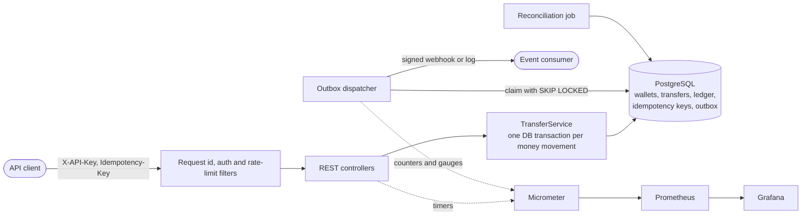
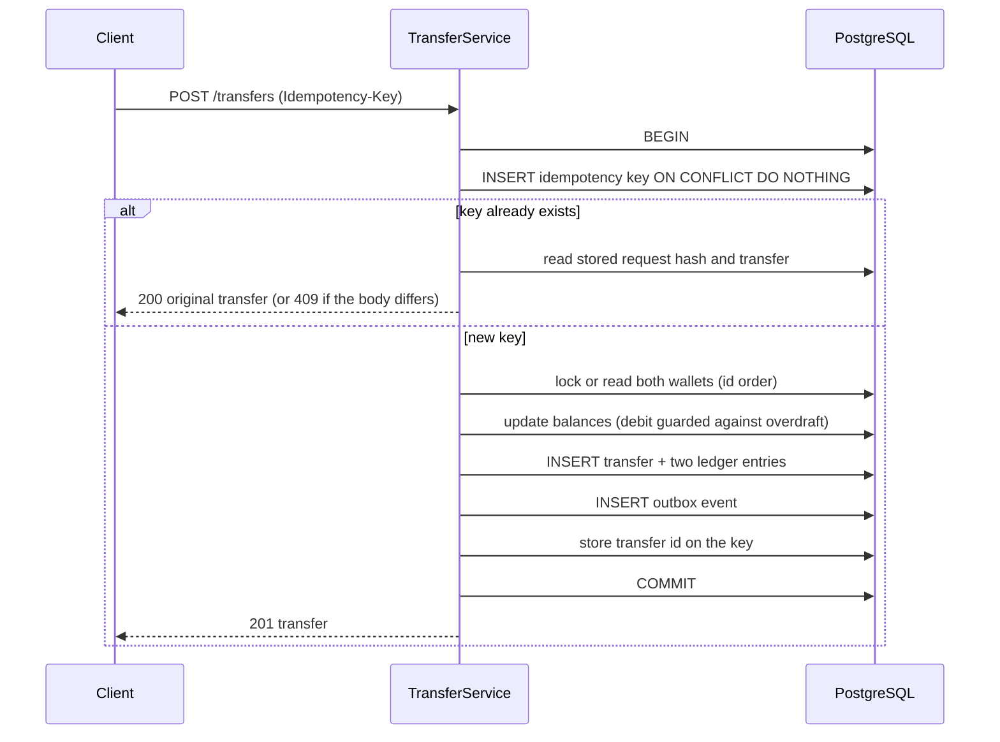
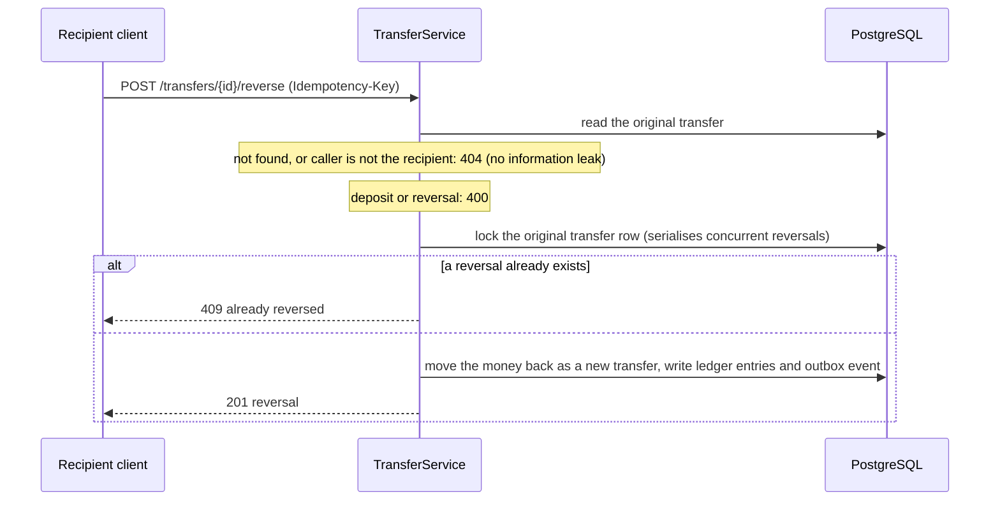
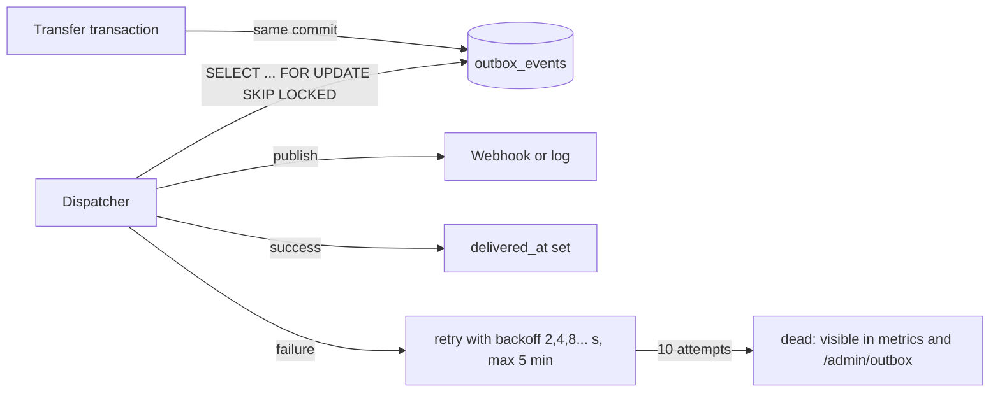

# LedgerX architecture and design notes

## Overview

Everything that matters for correctness happens inside one PostgreSQL transaction. The rest of the system (events, metrics, audits) is built around that transaction, not in place of it.

## What one transfer does

If anything fails between BEGIN and COMMIT (an error, a killed database session), PostgreSQL rolls all of it back: balances, ledger entries, the outbox event and the idempotency key. A retry therefore starts from scratch.

## Reversals (refunds)

A reversal is a normal transfer in the opposite direction that carries `reverses_transfer_id`. History is compensated, never edited, so the ledger stays append-only.

- Only the owner of the original **recipient** wallet may reverse, because that is whose money moves. If the recipient has already spent it, the reversal fails with 422 and nothing changes; the system never creates negative balances.
- A unique partial index on `reverses_transfer_id` guarantees at most one reversal per transfer even if application logic were bypassed. Reconciliation also checks that every reversal mirrors its original (same amount, opposite direction).

## Events: the transactional outbox

The problem: after money moves, other systems need to know, but "commit, then send a message" can lose the message if the process dies in between, and "send, then commit" can announce a transfer that never happened.

The solution: the event is a row in `outbox_events`, written in the **same transaction** as the transfer. An event exists if and only if the transfer committed. A dispatcher delivers rows afterwards.

- **At-least-once delivery.** A crash after delivery but before the row is marked delivered causes a redelivery. Every event carries a stable id (`X-Ledgerx-Event-Id`) so consumers deduplicate.
- **Parallel dispatchers are safe.** `SKIP LOCKED` lets several threads or application instances claim different rows, so no event is delivered twice by concurrent dispatchers (tested with four racing dispatchers).
- **Webhook bodies are signed** with HMAC-SHA256 (`X-Ledgerx-Signature`), so a receiver can verify the sender.
- **Ordering is not guaranteed** across retries. Consumers that care should order by `occurredAt` or the transfer id chain.
- **Trade-off:** a batch holds row locks while it publishes. The batch size is small (20) and the webhook timeout short (3 s) to bound that.

## API keys and rate limiting

- A client can hold several keys. **Rotation** issues a new key and lets existing keys live for a grace period (default 1 hour, 0 for immediate), so a new key can be rolled out without downtime. Rotating again never extends a key that is already expiring. Only SHA-256 hashes are stored. The last active key cannot be revoked, which would lock the client out.
- **Rate limiting** is a per-client token bucket (default 100 requests/s, burst 200) that answers `429` with `Retry-After`. Requests without a valid key are rejected before they can consume anyone's budget. The buckets live in memory, so with several instances each enforces its own limit; a global limit would need a shared store such as Redis.

## Invariants and how each is enforced

| Invariant | Enforced by | Proven by |
|---|---|---|
| Money is never created or destroyed: all balances sum to 0 | Every transfer is a debit plus an equal credit; deposits come from an EXTERNAL wallet | `ConcurrencyIT`, `ReconciliationIT` |
| A user wallet never goes negative | `CHECK (balance >= 0)` plus a guarded debit (`balance >= :amount`) or a row lock | `ConcurrencyIT.concurrentTransfersNeverOverspend` |
| The ledger is append-only | Trigger rejects UPDATE and DELETE | `TransferServiceIT.ledgerIsAppendOnly` |
| Balance equals the sum of the wallet's ledger entries | Same transaction writes both | `ReconciliationIT` (deliberately breaks it) |
| One logical transfer per idempotency key, even under races | `PRIMARY KEY (client_id, key)` and `ON CONFLICT DO NOTHING` | `ConcurrencyIT.concurrentDuplicateRequestsExecuteOnce` |
| No half-finished transfer after a crash | Single transaction | `FailureIT` (injected error, killed DB session) |
| A transfer is reversed at most once | Row lock on the original plus a unique partial index | `ReversalIT` (12 concurrent reversals produce exactly one) |
| An event exists if and only if its transfer committed | Event row written in the transfer's transaction | `OutboxIT` |
| No event is delivered twice by concurrent dispatchers | `FOR UPDATE SKIP LOCKED` | `OutboxIT` (four racing dispatchers) |
| A client only spends from its own wallets | Ownership check on the source wallet before money moves | `ApiIT` |
| An expired or revoked key stops working | Key lookup filters on `expires_at` and `revoked_at` | `KeyRotationIT` |
| A client cannot exceed its rate limit | Token bucket per client | `RateLimiterTest`, `RateLimitIT` |

## Decisions and trade-offs

**Integer minor units, no floating point.** `BIGINT` paise/cents. Rounding errors cannot happen.

**Cached balance next to the ledger.** Reading a balance would otherwise mean summing every entry. The cost is two sources of truth, which is why reconciliation exists: the ledger wins, and any disagreement is reported.

**Two lock strategies, measured rather than assumed.**
- `PESSIMISTIC`: `SELECT ... FOR UPDATE` on both wallets in id order, then check the balance in Java. Simple to reason about; holds row locks for the whole transaction.
- `CONDITIONAL_UPDATE`: no explicit lock. The debit is a single `UPDATE ... WHERE balance >= :amount`; the two updates run in id order so opposing transfers cannot deadlock. Shorter lock holding time, but the correctness argument is subtler.
- Results are in [BENCHMARKS.md](BENCHMARKS.md).

**Idempotency inside the same transaction.** The key row and the transfer commit together, so there is no window where the money moved but the key is missing (or the reverse). A concurrent duplicate blocks on the unique index until the first request finishes, then returns its result. A failed transfer does not consume its key.

**Failures are not cached.** An insufficient-funds response is not stored against the key. Retrying after the balance changes gets a fresh evaluation. Caching every response (as some payment APIs do) would need a response column and more states.

**Reconciliation reads one snapshot.** It runs at REPEATABLE READ, so transfers committing during the audit cannot cause false alarms.

**An outbox instead of a message broker.** The outbox gives reliable event delivery using the database the system already depends on. A broker would add operational weight without solving a problem this system has; the `EventPublisher` interface is the seam where one could be plugged in.

**Compensation over mutation.** Refunds are new ledger rows pointing at the original. Auditors can see both the payment and the refund, and no code path ever edits history.

## Limitations (stated openly)

- Single PostgreSQL primary. No sharding; throughput is bounded by one database. Replication and failover are not covered.
- Rate limiting is per application instance (in memory).
- API keys have no scopes; any key can do anything its client can do.
- One currency per transfer; no FX.
- Reconciliation detects problems but does not repair them.
- Event delivery is at-least-once and unordered under retries; consumers must deduplicate.
- Benchmarks come from one laptop running the app, the database and the load generator together. They show relative behaviour between strategies, not production capacity.
- Not covered: PostgreSQL itself losing committed data (that is the database's durability guarantee, and `fsync`/replication settings are out of scope here), and clock or network partitions between multiple app instances.

## Diagnosing a slow or failed transfer

1. Every response carries `X-Request-Id`; the same id is in every log line for that request (JSON logs in Docker).
2. `ledgerx_transfer_seconds` by `outcome` shows whether slowness or errors dominate; `insufficient_funds`, `rejected` and `idempotency_conflict` are client errors, `error` is ours.
3. `hikaricp_connections_pending > 0` means requests are waiting for a database connection, so the pool or the transaction length is the bottleneck, not the SQL.
4. `/admin/reconciliation` confirms that nothing was left inconsistent.
5. `ledgerx_outbox_pending` growing, or `ledgerx_outbox_dead` above zero, means events are not reaching the consumer; `/admin/outbox` shows the backlog and `/admin/outbox/requeue-dead` replays dead events once the consumer is back.
