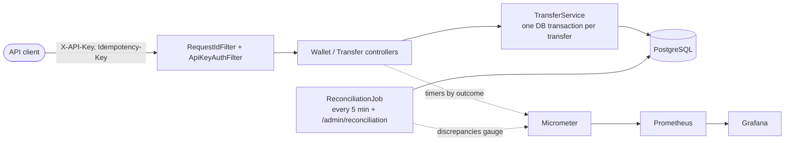
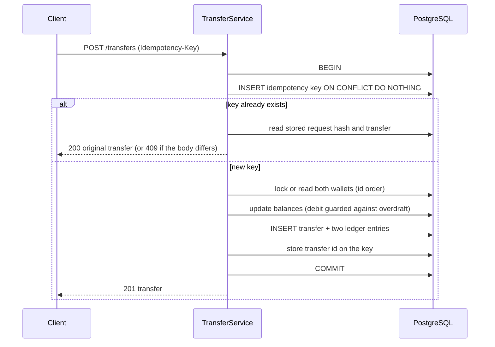

# LedgerX architecture and design notes

## Overview

## What one transfer does

Everything between BEGIN and COMMIT is one transaction. If anything fails (an error, a killed database
session) PostgreSQL rolls all of it back, including the idempotency key, so a retry runs from scratch.

## Invariants and how each is enforced

| Invariant | Enforced by | Proven by |
|---|---|---|
| Money is never created or destroyed: all balances sum to 0 | Every transfer is a debit plus an equal credit; deposits come from an EXTERNAL wallet | `ConcurrencyIT`, `ReconciliationIT` |
| A user wallet never goes negative | `CHECK (balance >= 0)` plus a guarded debit (`balance >= :amount`) or a row lock | `ConcurrencyIT.concurrentTransfersNeverOverspend` |
| The ledger is append-only | Trigger rejects UPDATE and DELETE | `TransferServiceIT.ledgerIsAppendOnly` |
| Balance equals the sum of the wallet's ledger entries | Same transaction writes both | `ReconciliationIT` (deliberately breaks it) |
| One logical transfer per idempotency key, even under races | `PRIMARY KEY (client_id, key)` and `ON CONFLICT DO NOTHING` | `ConcurrencyIT.concurrentDuplicateRequestsExecuteOnce` |
| No half-finished transfer after a crash | Single transaction | `FailureIT` (injected error, killed DB session) |
| A client only spends from its own wallets | Ownership check after the source wallet is read | `ApiIT` |

## Decisions and trade-offs

**Integer minor units, no floating point.** `BIGINT` paise/cents. Rounding errors cannot happen.

**Cached balance next to the ledger.** Reading a balance would otherwise mean summing every entry. The cost is two
sources of truth, which is why reconciliation exists: the ledger wins, and any disagreement is reported.

**Two lock strategies, measured rather than assumed.**
- `PESSIMISTIC`: `SELECT ... FOR UPDATE` on both wallets in id order, then check the balance in Java. Simple to reason
  about; holds row locks for the whole transaction.
- `CONDITIONAL_UPDATE`: no explicit lock. The debit is a single `UPDATE ... WHERE balance >= :amount`; the two updates
  run in id order so opposing transfers cannot deadlock. Shorter lock holding time, but the correctness argument is subtler.
- Results are in [BENCHMARKS.md](BENCHMARKS.md).

**Idempotency inside the same transaction.** The key row and the transfer commit together, so there is no window where
the money moved but the key is missing (or the reverse). A concurrent duplicate blocks on the unique index until the
first request finishes, then returns its result. A failed transfer does not consume its key.

**Failures are not cached.** An insufficient-funds response is not stored against the key. Retrying after the balance
changes gets a fresh evaluation. Stripe-style "store every response" would need a response column and more states.

**Reconciliation reads one snapshot.** It runs at REPEATABLE READ, so transfers committing during the audit cannot
cause false alarms.

**No Kafka, no microservices.** Everything that matters is a single PostgreSQL transaction. A message broker would add
failure modes without solving a problem this system has.

## Limitations (stated openly)

- Single PostgreSQL primary. No sharding; throughput is bounded by one database.
- API keys are a minimal auth scheme: no rotation, expiry, scopes or rate limiting.
- One currency per transfer; no FX.
- Reconciliation detects problems but does not repair them.
- Benchmarks come from one laptop running the app, the database and the load generator together. They show relative
  behaviour between strategies, not production capacity.
- Not covered: PostgreSQL itself crashing and losing committed data (that is the database's durability guarantee, and
  `fsync`/replication settings are out of scope here), and clock or network partitions between multiple app instances.

## Diagnosing a slow or failed transfer

1. Every response carries `X-Request-Id`; the same id is in every log line for that request (JSON logs in Docker).
2. `ledgerx_transfer_seconds` by `outcome` shows whether slowness or errors dominate; `insufficient_funds` and
   `rejected` are client errors, `error` is ours.
3. `hikaricp_connections_pending > 0` means requests are waiting for a database connection, so the pool or the
   transaction length is the bottleneck, not the SQL.
4. `/admin/reconciliation` confirms that nothing was left inconsistent.
